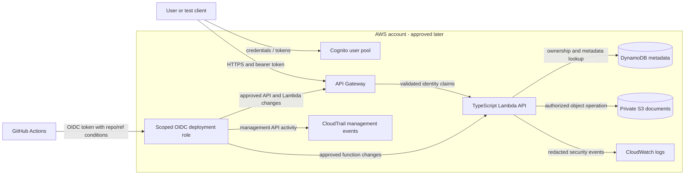

# Planned architecture and trust boundaries

This is a target design, not deployed infrastructure. The initial API will be local with synthetic data. Reassess the cloud design before Terraform is applied.

| Trust boundary | Threat | Planned control |
| --- | --- | --- |
| Client to API Gateway | Forged tokens, IDs, headers, uploaded bytes | HTTPS, authentication, schema/size limits; request fields never confer authority. |
| Gateway to Lambda | A valid identity requests another user's object | Lambda checks function and resource permission on every operation. |
| Lambda to DynamoDB/S3 | Broad service role or client-controlled object key | Narrow runtime IAM, trusted metadata lookup, server-generated keys, private S3. |
| GitHub to AWS | Workflow or branch compromise | OIDC audience/repository/ref conditions and scoped deployment policy. |
| API to logs | Sensitive data or log injection | Structured, redacted events with bounded retention. |

## Initial API and data assumptions

- Alice and Bob are synthetic users. Each document has one immutable owner from authenticated identity. There is no sharing or admin function in the MVP.
- The five planned routes are `POST /documents`, `GET /documents`, `GET /documents/{id}`, `GET /documents/{id}/content`, and `DELETE /documents/{id}`. The [OpenAPI contract](api-contract.yaml) and [authorization matrix](authorization-matrix.md) define their behavior.
- Create requests carry only a JSON `content` string. The content is nonempty UTF-8 text, at most 100,000 encoded bytes (decimal 100 KB). Arbitrary files, filenames, archives, update, and sharing are out of MVP scope.
- Metadata includes a server-generated UUID, owner subject, internal storage key, byte size, and creation time. Ownership and keys are never client-supplied. Bytes live in S3 only after an approved deployment; content is returned through the API, not a presigned URL.
- No VPC or NAT gateway is planned for the minimum serverless path. Private S3 does not mean the API endpoint is private.

Verify unauthenticated denial, cross-user denial for each implemented operation, S3 public-access denial, and OIDC trust conditions. A privileged-route test applies only if a privileged route is introduced later. See [requirements](security-requirements.md), [decisions](security-decisions.md), and [threat model](../security/threat-model/README.md).
