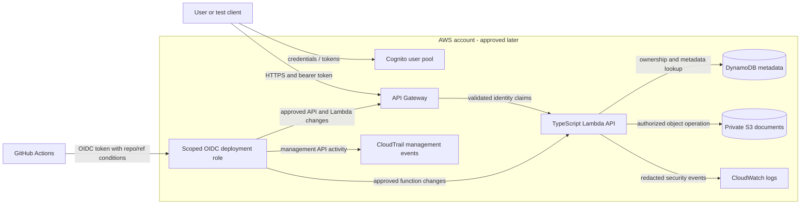

# Planned architecture and trust boundaries

This is a target design, not deployed infrastructure. The initial API will be local with synthetic data. Reassess the cloud design before Terraform is applied.

| Trust boundary | Threat | Planned control |
| --- | --- | --- |
| Client to API Gateway | Forged tokens, IDs, headers, uploaded bytes | HTTPS, authentication, schema/size limits; request fields never confer authority. |
| Gateway to Lambda | A valid identity requests another user's object | Lambda checks function and resource permission on every operation. |
| Lambda to DynamoDB/S3 | Broad service role or client-controlled object key | Narrow runtime IAM, trusted metadata lookup, server-generated keys, private S3. |
| GitHub to AWS | Workflow or branch compromise | OIDC audience/repository/ref conditions and scoped deployment policy. |
| API to logs | Sensitive data or log injection | Structured, redacted events with bounded retention. |

## Initial API and data assumptions

- One owner per document, no sharing in minimum scope; two synthetic users for BOLA tests. An admin capability is optional and requires explicit function-level rules.
- Metadata consists of an opaque document ID, owner subject, storage key, type, size, and timestamps. Bytes live in S3 only after an approved deployment. Clients do not choose storage keys.
- Candidate operations: upload/create, list own, read metadata, download, delete. Update and sharing are unresolved. Tests should cover only implemented routes.
- Start with small synthetic text files or metadata-only records. Define allowed types, limits, download behavior, and malware handling before cloud uploads. This plan does not assert arbitrary file uploads are safe.
- No VPC or NAT gateway is planned for the minimum serverless path. Private S3 does not mean the API endpoint is private.

Verify unauthenticated denial, cross-user denial for each operation, function-level denial, S3 public-access denial, and OIDC trust conditions. See [requirements](security-requirements.md), [decisions](security-decisions.md), and [threat model](../security/threat-model/README.md).
